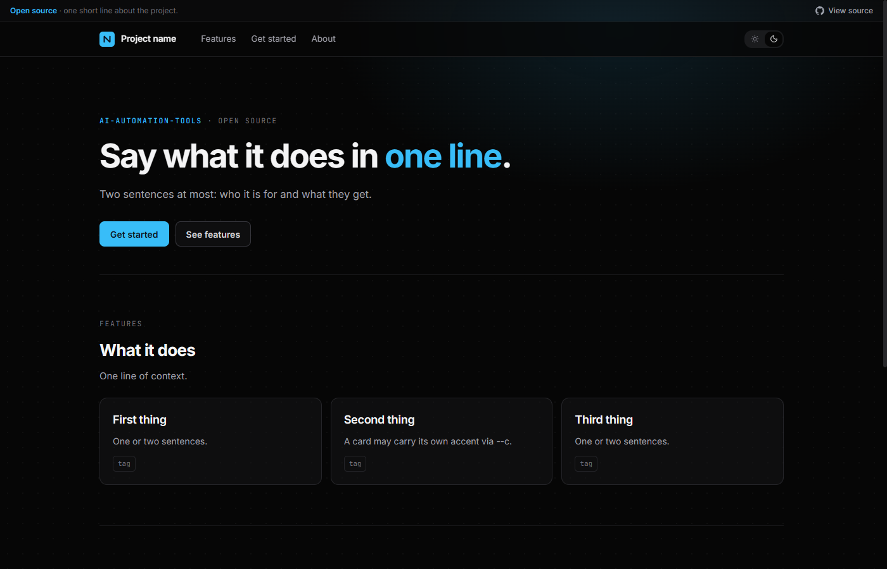
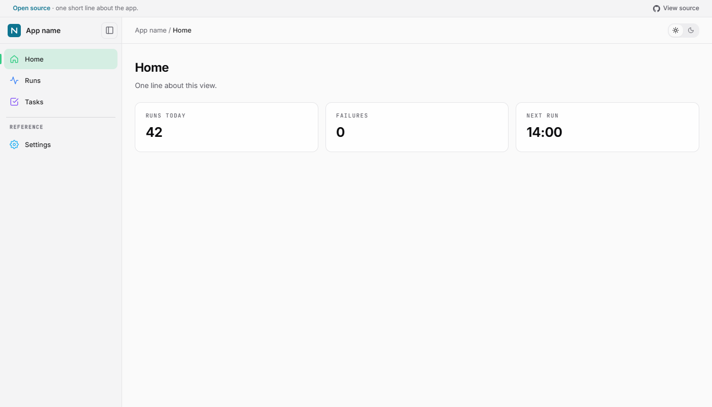

# 🎨 web-house-style

> **Overview page.** The skill itself is [`SKILL.md`](../../../../../Skills/Core/Web/web-house-style/SKILL.md) · [all Core skills](../../../../../README.md#-core-skills)

## What the skill does

[`web-house-style`](../../../../../Skills/Core/Web/web-house-style/SKILL.md) gives a new or existing page the shared look, feel and navigation of the `ai-automation-tools` sites: the near-black ground with a dot grid and zinc surfaces, one accent per site, Inter + JetBrains Mono, a Light | Dark switch in the top-right corner that defaults to dark and never flashes, a sticky top bar or a fixed icon sidebar, the "View source" bar across the top, the shared dark-tile app icon, and a phone pass.

| Starter | Use it for |
|:---|:---|
| [`assets/page.html`](../../../../../Skills/Core/Web/web-house-style/assets/page.html) | A **document page**: source bar in flow, sticky top bar with nav, hamburger sheet on phones. Landing, project and docs pages |
| [`assets/app-shell.html`](../../../../../Skills/Core/Web/web-house-style/assets/app-shell.html) | An **app shell**: fixed source bar, a collapsible icon sidebar, top bar beside it. Dashboards and tools with several destinations |

The tokens, components and phone rules are in [`references/design-system.md`](../../../../../Skills/Core/Web/web-house-style/references/design-system.md).

## Files

Nothing bulky is checked in here yet. The screenshots above are the showcase site's, in [`site/assets/img/`](../../../../../site/assets/img/README.md).

---

  <a href="../../../../README.md">← Resources home</a> ·
  <a href="../../../../../Skills/Core/Web/web-house-style/SKILL.md">The skill →</a>

